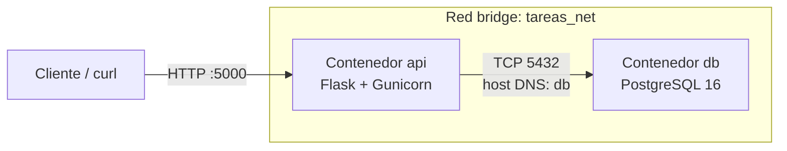

# Proyecto 1 — Integración Continua (Escenario 3)

**Asignatura:** Integración Continua  
**Institución:** Politécnico Grancolombiano  
**Estudiante (líder de repo):** David Gómez (`dagomezm9@poligran.edu.co`)  
**Grupo:** Esteban · Freddy · Jholman · David

## Objetivo

Construir un proyecto de software alojado en GitHub que utilice **Docker** para levantar **dos contenedores que se comunican entre sí**:

1. **api** — API REST de tareas (Python + Flask + Gunicorn)
2. **db** — Base de datos PostgreSQL 16

La orquestación se hace con `docker-compose.yml` sobre una red definida por el usuario (`tareas_net`). La API se conecta a la base de datos **por nombre de servicio** (`db`), gracias al DNS interno de Docker.

---

## Arquitectura



### Cómo se comunican los contenedores

- Ambos servicios se unen a la red bridge `tareas_net`.
- Docker Compose registra el nombre del servicio (`db`, `api`) como hostname DNS dentro de esa red.
- La variable `DATABASE_URL` de la API apunta a `postgresql://...@db:5432/tareas_db`.
- El servicio `api` declara `depends_on` con `condition: service_healthy`, de modo que solo arranca cuando el *healthcheck* de PostgreSQL (`pg_isready`) es exitoso.
- El volumen `tareas_db_data` persiste los datos; el script `db/init.sql` crea la tabla e inserta filas de ejemplo en el primer arranque.

---

## Estructura del repositorio

```
proyecto1/
├── app/
│   ├── Dockerfile          # Imagen de la API
│   ├── app.py              # Endpoints Flask
│   └── requirements.txt
├── db/
│   └── init.sql            # Esquema e inserts iniciales
├── docs/
│   └── evidencias.txt      # Salidas de curl (si se pudo ejecutar)
├── .github/workflows/
│   └── ci.yml              # Pipeline: build + healthcheck
├── docker-compose.yml
├── .env.example
├── .gitignore
└── README.md
```

---

## Requisitos

- Docker Engine 24+ y Docker Compose v2
- (Opcional) `curl` para las pruebas manuales

---

## Cómo ejecutar

```bash
# 1. Clonar el repositorio (cuando esté en GitHub)
# git clone <url-del-repo>
# cd proyecto1

# 2. Variables de entorno
cp .env.example .env

# 3. Construir e iniciar
docker compose up --build -d

# 4. Ver logs
docker compose logs -f

# 5. Detener y limpiar (incluye volumen)
docker compose down -v
```

---

## Endpoints

| Método | Ruta       | Descripción                          |
|--------|------------|--------------------------------------|
| GET    | `/health`  | Estado de la API y de la base de datos |
| GET    | `/tareas`  | Lista todas las tareas               |
| POST   | `/tareas`  | Crea una tarea (`{"titulo": "..."}`) |

---

## Cómo probar con curl

```bash
# Healthcheck
curl -s http://localhost:5000/health | jq

# Listar tareas (incluye las de init.sql)
curl -s http://localhost:5000/tareas | jq

# Crear una tarea
curl -s -X POST http://localhost:5000/tareas \
  -H "Content-Type: application/json" \
  -d '{"titulo":"Entregar proyecto 1"}' | jq

# Verificar que apareció
curl -s http://localhost:5000/tareas | jq
```

---

## Pipeline CI (GitHub Actions)

El workflow `.github/workflows/ci.yml` se ejecuta en cada push/PR a `main`:

1. Construye las imágenes con `docker compose up --build -d`
2. Espera a que `/health` responda `status: ok`
3. Prueba `GET /tareas` y `POST /tareas`
4. Baja los contenedores con `docker compose down -v`

Esto deja lista la base de integración continua para las entregas siguientes.

---

## Repartición del trabajo

| Integrante | Responsabilidad |
|------------|-----------------|
| **David Gómez** | Repositorio en GitHub, estructura del proyecto, `docker-compose.yml`, red y volúmenes |
| **Esteban** | Introducción, objetivos y descripción del proyecto en el informe |
| **Freddy** | Dockerfiles, explicación de la comunicación entre contenedores y capturas de evidencia |
| **Jholman** | Pruebas (curl / Postman), conclusiones y referencias bibliográficas |

---

## Autores

Grupo de trabajo — Integración Continua, Escenario 3.  
Politécnico Grancolombiano.
